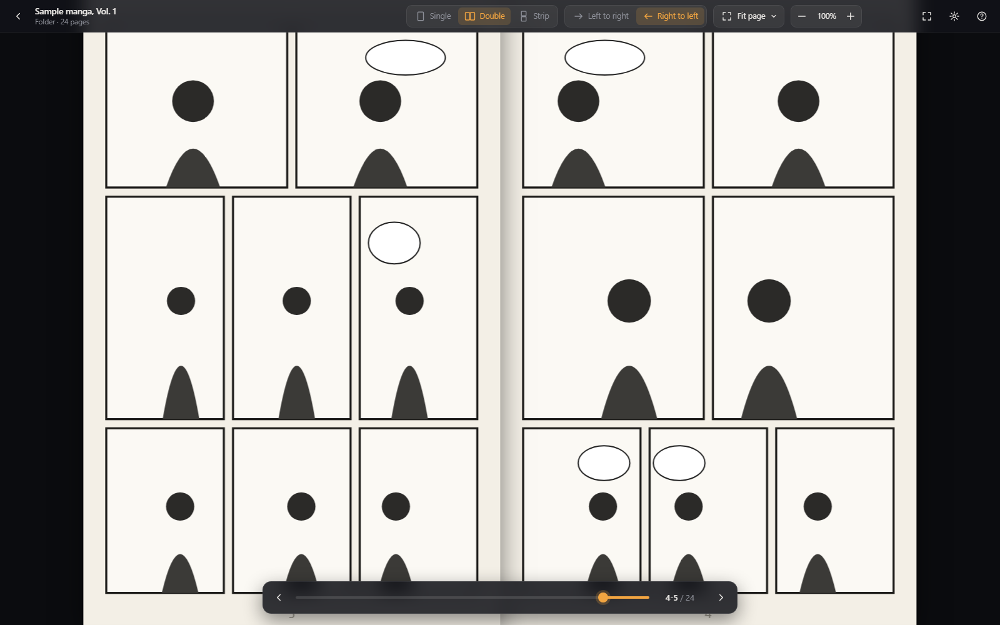

# Gettic's Comic-Manga reader

A comic and manga reader for Windows (work in progress).



## What it does

- **Opens** CBZ/ZIP, CBR/RAR, CB7/7z and PDF files, a folder of images, or a single image (it opens that image's folder there).
- **Images in folders:** jpg, png, webp, gif, avif and bmp, up to 2 subfolder levels deep.
- **Reading modes:** single page, double page, or strip (one long column, for webtoons).
- **Manga mode:** reads right to left. Keys, clicks, swipes and the page slider all follow the direction.
- **Fit and zoom:** fit width, fit height, fit page or original size, plus zoom.
- **Webtoons:** a comic with very tall pages switches to strip mode by itself the first time you open it.
- **Remembers:** the last page and the view of each comic, and a list of recent comics on the start screen.
- **Save as default:** the gear menu can make your current view the default for new comics.
- **Click zones:** click the left or right part of the page to turn it, the middle to show the controls. You can turn this off in the gear menu.
- **Opening comics:** use the open buttons, drag a file onto the window, or open it from Explorer. If the app is already running, the comic opens in that window.

Comics protected by a password are not supported.

## Get it and run it

It is a portable app: there is no installer.

1. Download the zip from the [Releases](https://github.com/gettic/Gettic-Comic-Manga-reader/releases) page.
2. Unzip it anywhere.
3. Run `gettics-comic-manga-reader.exe`.

**Needs:** Windows 10 or 11 with Microsoft Edge WebView2 (already part of Windows 11 and most Windows 10 PCs).

## Keyboard

The main keys. Press `?` in the app for the full list.

| Key | What it does |
| --- | --- |
| Left / Right (or A / D) | Page to the left / right |
| Space / Shift+Space | Next / previous page |
| Home / End | First / last page |
| 1 / 2 / 3 | Single page / double page / strip |
| R | Switch left-to-right / right-to-left |
| W / H / P / O | Fit width / fit height / fit page / original size |
| + / - / 0 | Zoom in / zoom out / reset zoom |
| G | Go to page |
| F or F11 | Fullscreen |
| Tab or M | Show or hide the controls |
| Ctrl+O / Ctrl+Shift+O | Open a file / open a folder |
| Esc | Close a menu, leave fullscreen, back to the start screen |

## Data and privacy

- Your progress and settings (`progress.json`, `settings.json`) are kept in a `data` folder next to the exe.
- If that folder can't be written to, they go to `%APPDATA%\com.gettic.comicmangareader` instead.
- The app never goes online.
- Your comic files are only read, never changed.

## Build from source

The app is made with Tauri 2, Vite and TypeScript. The Rust part is cross-built for Windows inside WSL.

### What you need

| Where | What |
| --- | --- |
| Windows | Node.js |
| Windows | WSL with a distro named `Ubuntu` |
| Ubuntu (WSL) | `clang`, `lld`, `llvm`, `rsync` |
| Ubuntu (WSL) | Rust with the `x86_64-pc-windows-msvc` target |
| Ubuntu (WSL) | `cargo-xwin` |
| Ubuntu (WSL), only for `npm run rust:test` | `libwebkit2gtk-4.1-dev`, `libxdo-dev`, `librsvg2-dev` |

### Build the exe

Run these in the project folder (where `package.json` is):

```
npm install
npm run exe
```

The exe ends up in `src-tauri\target\release\gettics-comic-manga-reader.exe` (about 11.5 MB).

### Commands

| Command | What it does |
| --- | --- |
| `npm run exe` | Builds the portable exe |
| `npm run exe:smoke` | Builds the exe, then runs its self-check |
| `npm run dev` | Runs the web part alone in a dev server |
| `npm run build` | Builds the web part alone |
| `npm test` | Runs the web part's tests |
| `npm run rust:check` | Checks the Rust code |
| `npm run rust:clippy` | Runs the Rust linter |
| `npm run rust:test` | Runs the Rust tests in Ubuntu (WSL) |

### Self-check

Run the exe with `--smoke-test`. It shows no window and ends with exit code 0 when all is OK.

## Credits and licenses

- PDF pages are turned into images with `jpeg-encoder`. This software is based in part on the work of the Independent JPEG Group.
- RAR and CBR support uses RARLAB's unRAR source code. Its license is freeware, not open source: it may be passed on, but not used to re-create the RAR compression method. The Rust code can be built without RAR support by leaving out the default `rar` feature (`--no-default-features`).
- All other libraries are under the MIT or Apache-2.0 license.
